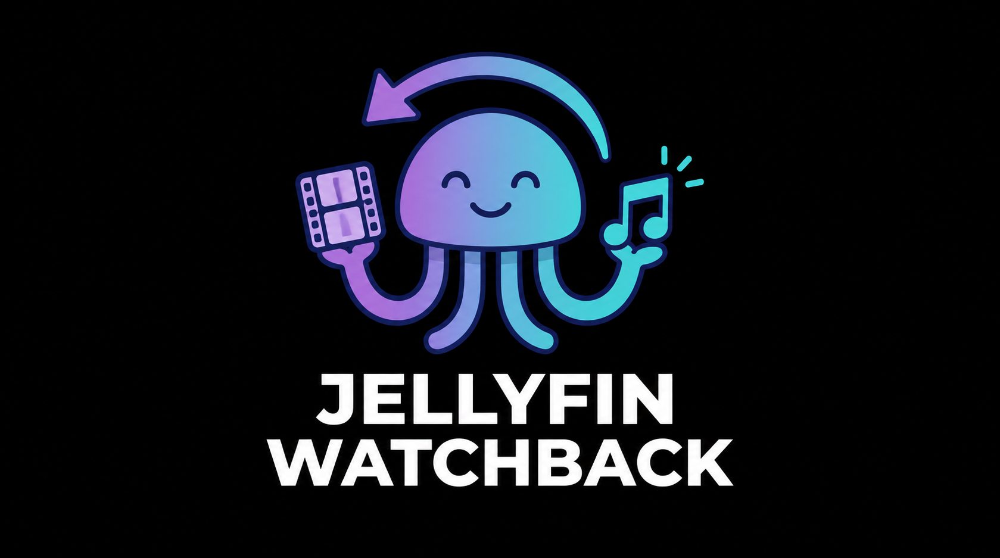

# Jellyfin Watchback



A [Jellyfin](https://jellyfin.org/) plugin that provides an annual playback rewind.

> **AI disclosure:** This project is AI-assisted but not vibe-coded. AI is used as a partner for post-change reviews, discussing specific problems, quick analysis, suggestions, and spell checking, never as a substitute for the logic, regression testing, code coverage, and static checks that gate every change. The translations are the main AI-generated content. It was built with a great deal of effort and care, and we deliberately do not trust AI blindly.
>

<table>
<tr>
<td style="vertical-align: top; text-align: center;">

**Project**

[](https://jellyplugins.github.io/jellyfin-watchback/)<br>
[](Jellyfin.Plugin.Watchback/i18n/)<br>
[](https://github.com/JellyPlugins/jellyfin-watchback/releases)

</td>
<td style="vertical-align: top; text-align: center;">

**Quality**

[](https://sonarcloud.io/summary/new_code?id=JellyPlugins_jellyfin-watchback)<br>
[](https://codecov.io/gh/JellyPlugins/jellyfin-watchback)<br>
[](https://app.codecov.io/gh/JellyPlugins/jellyfin-watchback/flags)<br>
[](test/e2e/)

</td>
<td style="vertical-align: top; text-align: center;">

**Stack**

[](https://jellyfin.org/)<br>
[](https://dotnet.microsoft.com/)<br>
[](LICENSE)

</td>
</tr>
</table>

## Live Demo

**[Try the interactive demo →](https://jellyplugins.github.io/jellyfin-watchback/)**

Explore the per-user annual playback report with sample data.
No Jellyfin server required.

---

## Features

- Viewing hours, films, episodes, series and active days.
- Listening hours, track and play counts, top 5 tracks by listening time, monthly listening chart and music genre chart with monthly selection.
- Monthly viewing and listening charts, a film/series/music mix, and genre charts with monthly selection.
- Viewing times, weekdays, combined film/series/music active-day streak with separate video and music streaks, and comparison with the previous report.
- Eight languages: English, German, French, Spanish, Portuguese, Chinese, Turkish and Swedish. Both the personal page and administration settings follow the active Jellyfin user’s display language, with English fallback for unsupported languages.

Activity is recorded whenever the plugin runs, independently of whether the annual page is enabled. The page is **disabled by default**. Available Jellyfin state can reconstruct a known playback per title; old session history, exact viewing times and repeated plays cannot be recovered from lifetime totals. Estimates remain visibly separate from measured playback. Initially Watchback checks for the [Playback Reporting](https://github.com/jellyfin/jellyfin-plugin-playbackreporting) plugin to create the initial history as accurately as possible.

At the annual cutoff, Watchback publishes one fixed JSON report per user. Opening the annual page loads that user's saved file directly, without rebuilding the report or querying the current library. Later playback, metadata changes and library permission changes do not alter a published report. If no report file exists for the signed-in user, the page displays a message. The next annual report replaces the previous file and retains its comparison values.

Enable **Yearly Rewind** in the plugin settings and choose its annual display period (default **15 December–15 January**, inclusive). At 00:00 server time on the first day, the preceding annual period is frozen into one report per user. The report is replaced the next year. Hiding the tab after the configured end date keeps the report on disk. Changing the display settings never finalizes or rewrites an existing annual report.

Genre charts count the full playback time for every genre assigned to a title. Their percentages use the sum of genre times, which can exceed actual playback time.

The collector covers video and music playback. Music statistics appear only when the report contains qualifying music activity.

## Installation

### From Repository (Recommended)

1. In Jellyfin, go to **Dashboard** → **Plugins** → **Repositories**
2. Add this repository URL:
   ```
   https://raw.githubusercontent.com/JellyPlugins/jellyfin-watchback/main/manifest.json
   ```
3. Go to **Catalog** and install **Jellyfin Watchback**
4. Restart Jellyfin

### Manual Installation

1. Download the latest release package from [Releases](https://github.com/JellyPlugins/jellyfin-watchback/releases)
2. Extract the package and copy all files into your Jellyfin plugin directory (e.g. `/config/plugins/JellyfinWatchback/`)
3. Restart Jellyfin

---

## Quick Start

1. Open **Jellyfin Watchback** from the sidebar.
2. Enable Yearly Rewind, choose the annual display period, and save.
3. Wait for the configured time to come and visit the report page.

---

## Documentation

| Resource                                                     | Description                                                               |
|--------------------------------------------------------------|---------------------------------------------------------------------------|
| [CONTRIBUTING.md](CONTRIBUTING.md)                           | Project structure, builds, testing, releases and GitHub repository setup. |
| [CHANGELOG.md](CHANGELOG.md)                                 | Detailed version history                                                  |
| [Live Demo](https://jellyplugins.github.io/jellyfin-watchback/) | Interactive dashboard demo                                                |


## License

GNU General Public License v3.0. See [LICENSE](LICENSE).
